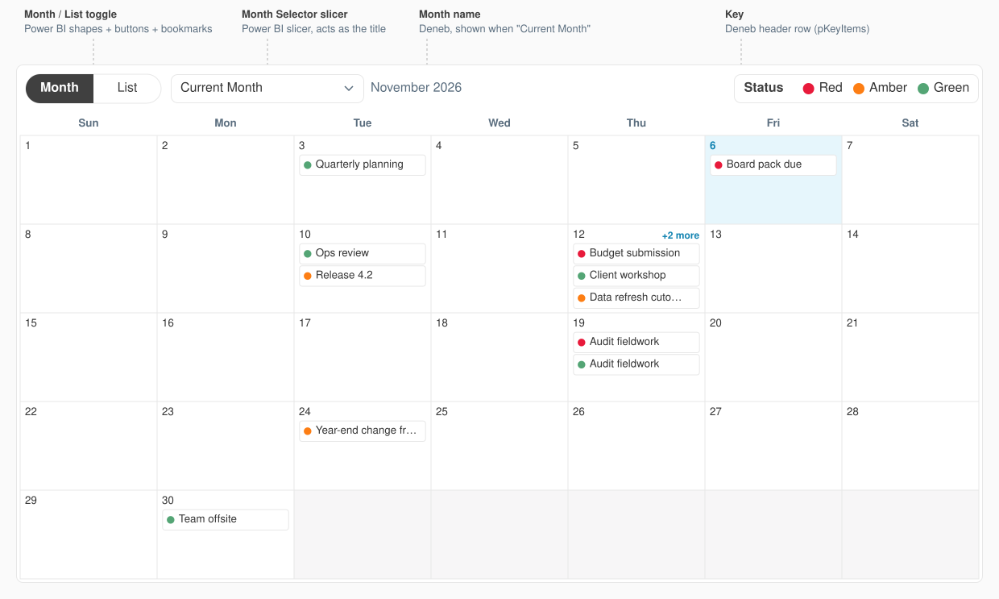

# general-deneb-calendar-visual

A Copilot agent skill that builds a **month calendar** for any Power BI report using the Deneb custom visual: dated items on a Sunday–Saturday grid as plain cards with a RAG status circle (Red / Amber / Green, BDO theme colours), a boxed "Status" key in the header, "+N more" when a day is full, and a panel listing every item when you click a day. All font sizes follow one type scale, and there are steps for an optional Month / List toggle with the month picker as the calendar's title.

It works with any report because the visual uses fixed role names (`Item Key`, `Item Label`, `Item Category`). You rename your own fields to those names in the Deneb visual, so the visual itself doesn't need field edits.

## Install
1. Copy the whole `general-deneb-calendar-visual` folder (don't rename it) into your workspace at `.github/skills/general-deneb-calendar-visual/`.
   Or keep it anywhere and add its **parent** folder to the VS Code setting `chat.agentSkillsLocations`.
2. Run **Developer: Reload Window**.
3. In Copilot Chat type `/` and check `general-deneb-calendar-visual` is listed.

## Use
Type `/general-deneb-calendar-visual` and describe what you want, e.g.:
- `/general-deneb-calendar-visual build a calendar of tasks by due date for C:\Reports\Team Tracker.pbip`
- "I have a .pbix with an Events table - make me a Deneb month calendar of events coloured by event type"
- "Re-theme my Deneb calendar with this theme file" (attach your Power BI theme `.json`)

Have ready:
- The report (`.pbip` folder, or a `.pbix` — the agent will ask you to run a DAX query and paste the result, because it can't read inside a `.pbix`).
- Which table and date the items come from, what to show on each card, and optionally a RAG status column (Red / Amber / Green).
- Your **colour theme**: the BDO theme is the default (RAG status key Red / Amber / Green, Trebuchet MS, 16 / 12 / 10 / 9 pt type scale). Or give a Power BI theme `.json` or hex codes, plus font sizes if you have a type scale.
- Whether you want a Month / List toggle (calendar and a table in the same spot).

You get back (your report is never edited):
- DAX for a `'Deneb Calendar'` table and steps to add it in Power BI Desktop.
- A commented spec in a `deneb/` folder next to your report, themed for you.
- Sample data and a browser preview to check it.
- Numbered Power BI Desktop steps (including the header controls and bookmarks if you asked for the toggle).

## Optional: Month / List toggle (added in Power BI)
You can make the month picker the calendar's title and add a **Month | List** switch that swaps the calendar for a table in the same spot. These controls are **not part of the Deneb spec** — you add them in Power BI Desktop (shapes, buttons, a slicer and two bookmarks) on top of the calendar's header row, so the **browser preview won't show them**. The agent gives you exact positions and settings; see [powerbi-setup.md → Header controls](./references/powerbi-setup.md#header-controls-optional).

What it looks like in Power BI (illustration using the skill's sample data):

In the spec, set `pTitleMode` to `"note"` so the calendar only adds the month name next to the slicer, and `pControlsPx` so it starts after the controls.

## Requirements
- Power BI Desktop with the **Deneb** visual (free, certified, from AppSource).
- Internet access to cdn.jsdelivr.net for the browser preview only.
